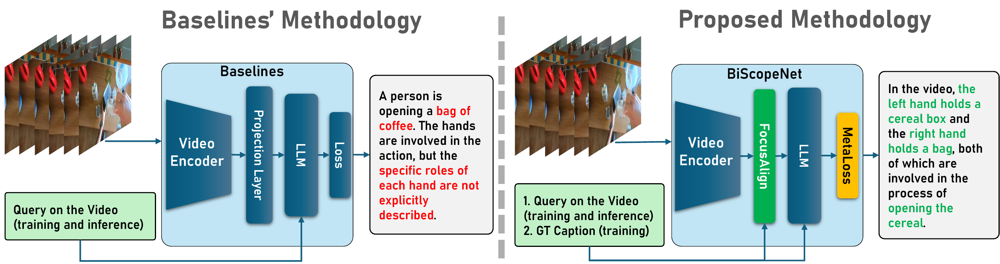
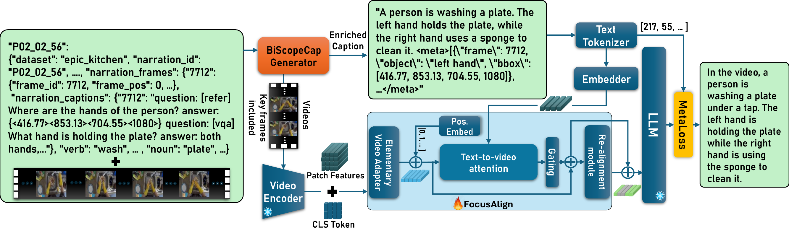

<div align="center">

# Sub-actions in Action: Text-Guided Hand-Role Alignment for Sub-Action Recognition

**Sadegh Rahmaniboldaji<sup>1</sup> · Filip Rybansky<sup>2</sup> · Quoc Vuong<sup>2</sup> · Frank Guerin<sup>1</sup> · Andrew Gilbert<sup>1</sup>**

<sup>1</sup>University of Surrey &nbsp;&nbsp; <sup>2</sup>Newcastle University

**BMVC 2026**

[](TODO)
[](TODO)
[](https://huggingface.co/datasets/SadeghRahmaniB/BiScopeCap)
[](LICENSE)

</div>

<p align="center">
  
</p>
<p align="center"><em>Standard Video-LLMs describe the overall action but not each hand's role. BiScopeNet adds FocusAlign and MetaLoss to produce hand-aware, object-grounded captions.</em></p>

## Overview

Video-language models usually describe the **high-level action** in an egocentric clip ("a person is picking up a pan"). They rarely say **what each hand is doing** ("the right hand holds the pan while the left hand holds the lid"). We call this missing layer **sub-actions**, and introduce:

- **Sub-action detection**: a task that requires a model to recognise the high-level action, the **left- and right-hand roles**, and the objects they manipulate.
- **[BiScopeCap-100K](https://huggingface.co/datasets/SadeghRahmaniB/BiScopeCap)**: a video-level egocentric captioning dataset built from EPIC-KITCHENS / VISOR, Ego4D, HD-EPIC and HOI-QA. Each caption describes the action and each hand's role, and comes with spatial metadata (per-keyframe hand and object boxes).
- **BiScopeNet**: a backbone-agnostic framework that adds two components to existing Video-LLMs while keeping the vision encoder and LLM frozen:
  - **FocusAlign**: a gated, text-guided attention projector that re-weights video tokens towards action-relevant regions.
  - **MetaLoss**: a cross-entropy loss that masks the `<meta>…</meta>` spans and up-weights object tokens (λ<sub>o</sub> = 3).

## Method

<p align="center">
  
</p>
<p align="center"><em>Overview of BiScopeNet. Video tokens from the frozen encoder pass through FocusAlign (Elementary Video Adapter → positional embedding → text-to-video attention → gated residual → re-alignment module) before reaching the frozen LLM. MetaLoss masks the <code>&lt;meta&gt;</code> spans and up-weights object tokens in the training loss.</em></p>

## Results

Results on BiScopeCap (from the paper; LLM-judge accuracy in %):

| Method | Backbone | Trained | ActRec ↑ | RH ↑ | LH ↑ | ObjRec ↑ | # Unstruct ↓ |
|---|---|:-:|---:|---:|---:|---:|---:|
| Qwen 3.5 | – | ✗ | 26.0 | 32.2 | 40.6 | 53.3 | 6 |
| NVILA | – | ✓ | 44.0 | 43.0 | 39.1 | 58.0 | 0 |
| Qwen 3.5 | – | ✓ | 41.8 | 42.0 | 40.0 | 54.3 | 40 |
| VideoChatGPT | – | ✓ | 14.3 | 13.7 | 17.7 | 30.1 | 488 |
| BiScopeNet (CLIP) | VideoChatGPT | ✓ | 30.7 | 19.4 | 29.6 | 47.9 | 7 |
| BiScopeNet (DINOv3) | VideoChatGPT | ✓ | 33.4 | 31.9 | 31.4 | 53.5 | 5 |
| **BiScopeNet (SigLIP)** | **NVILA** | ✓ | **45.5** | **44.9** | **41.2** | **58.9** | **0** |

See the paper for zero-shot baselines, per-subset results and ablations.

## Dataset

BiScopeCap is hosted on Hugging Face: **[SadeghRahmaniB/BiScopeCap](https://huggingface.co/datasets/SadeghRahmaniB/BiScopeCap)**. The dataset card there documents the fields, splits, curation and licence.

<p align="center">
  
</p>
<p align="center"><em>BiScopeCap curation. Frame-level annotations from HD-EPIC, Ego4D, EPIC-KITCHENS / VISOR and HOI-QA are turned into video-level captions with Gemini. A final step crops the clips and aligns the spatial metadata to the keyframes.</em></p>

```python
from datasets import load_dataset

ds = load_dataset("SadeghRahmaniB/BiScopeCap")
print(ds)  # train: 92,868 clips, validation: 9,879 clips
```

Each record is in the LLaVA conversation format. The target caption ends with a `<meta>` span that holds the grounding boxes:

```text
A person is closing a door. The right hand is holding and manipulating the door to close it.
<meta>[{"frame": 21, "object": "door", "bbox": [118, 0, 106, 199]},
       {"frame": 21, "object": "right hand", "bbox": [155, 151, 21, 73]}, ...]</meta>
```

`bbox` is `[x, y, w, h]` in the 224 × 224 resized frame. `frame` is a clip-relative index and is one of the record's `key_frames`.

> [!IMPORTANT]
> **No videos are redistributed.** Download the source videos under their own licences ([EPIC-KITCHENS](https://epic-kitchens.github.io), [Ego4D](https://ego4d-data.org), [HD-EPIC](https://hd-epic.github.io)). Then trim clips at the narration timestamps with the scripts below.
> 

## Usage
This repository contains the code used to **build BiScopeCap**, which include the **FocusAlign** and **MetaLoss** scripts which can be used on any model backbones.


## Evaluate predictions (LLM-as-a-judge)

Predictions are scored by GPT-5 mini on five criteria: action, left hand, right hand, objects and caption structure. The full judge prompt is in the supplementary material.

## Citation

```bibtex
@inproceedings{rahmaniboldaji2026subactions,
  title     = {Sub-actions in Action: Text-Guided Hand-Role Alignment for Sub-Action Recognition},
  author    = {Rahmaniboldaji, Sadegh and Rybansky, Filip and Vuong, Quoc and Guerin, Frank and Gilbert, Andrew},
  booktitle = {British Machine Vision Conference (BMVC)},
  year      = {2026}
}
```

## Acknowledgements

This work was funded by the Leverhulme Trust Research Project Grant RPG-2023-079. BiScopeCap builds on [EPIC-KITCHENS](https://epic-kitchens.github.io), [EPIC-KITCHENS VISOR](https://epic-kitchens.github.io/VISOR), [Ego4D](https://ego4d-data.org), [HD-EPIC](https://hd-epic.github.io) and [HOI-Ref](https://github.com/Sid2697/HOI-Ref). We integrate BiScopeNet into [VideoChatGPT](https://github.com/mbzuai-oryx/Video-ChatGPT), [NVILA](https://github.com/NVlabs/VILA) and [Qwen3.5](https://huggingface.co/Qwen/Qwen3.5-9B) to assess its effectiveness.
